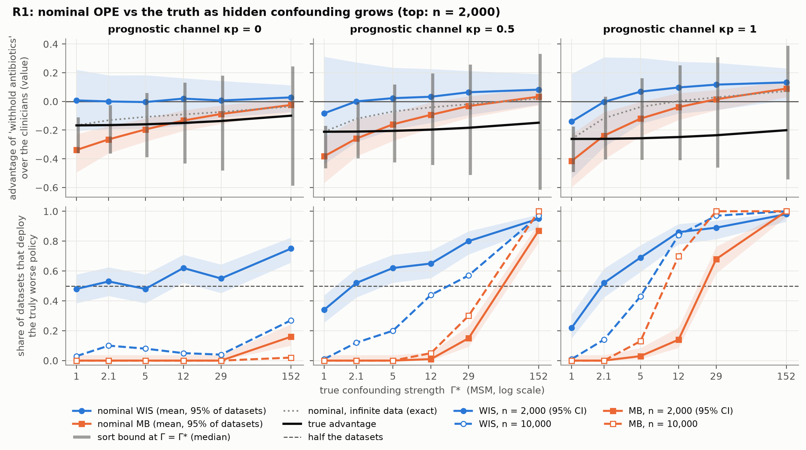

# Breaking Point: When Hidden Confounding Flips Off-Policy Evaluation

[](https://doi.org/10.5281/zenodo.23881233)



Off-policy evaluation (OPE) under hidden confounding, studied on the sepsis simulator of Oberst &
Sontag (2019). A hidden variable of known strength influences the clinicians' antibiotic decisions
and the patients' transitions. The simulator is ported to an exact transition tensor, so true
policy values, the confounding strength Γ* and the infinite-data limit of every estimator are
computed exactly.

**Main result.** With 10,000 episodes, weighted importance sampling and a model-based estimate
recommend withholding antibiotics, a policy truly worse than the clinicians' by 0.25 in value, in
84% and 70% of datasets once Γ* reaches 12 and the hidden variable also worsens outcomes directly.
When it harms only untreated patients, they do so in at most 27% of datasets even at Γ* = 152, and
with infinite data never. A breakdown-Γ alarm calibrated on recorded variables fires on every
deploy decision in this regime, right or wrong (recall 1.00, precision 0.32, equal to the base
rate).

The full report, with methods, figures and references, is [REPORT.md](REPORT.md).

## Results at a glance

| Question | Answer |
| --- | --- |
| When does OPE recommend a worse policy? | Withholding antibiotics is truly worse than the clinicians by 0.10 to 0.26 in every cell. With infinite data the nominal estimators prefer it from Γ* = 12 when the hidden variable also lowers oxygen regardless of treatment (κp = 1), from Γ* = 152 at κp = 0.5, and never at κp ≤ 0.3. With 10,000 episodes WIS and MB follow this exact frontier. With 2,000 or fewer, finite-sample bias decides: WIS deploys the worse policy in 22% to 49% of datasets without any confounding, while MB, biased the other way, waits until Γ* ≥ 29. |
| Do sensitivity bounds cover the truth? | Where they are designed to, given enough data. At Γ = Γ* > 1 with 10,000 episodes the sort bound covers the true value in 99.9% of R1 datasets (median width 0.21 on a value scale of 2) and robust DP in 96% of R2 datasets; with 2,000 episodes, 87% and 86%. The naive box covers but is uninformative: median width 1.5 to 1.9 in R1, hundreds to thousands in R2. |
| Does a breakdown-point alarm warn in time? | It fires on almost everything. The benchmark Γ̂ is large (medians 29 to 49) because the clinicians' protocol is a nearly deterministic function of the recorded vitals, so the alarm fires on 86% to 100% of deploy decisions, with precision no better than the base rate. Three quarters of the wrong deployments are an RL policy evaluated on its own training data, an overfitting error that no confounding analysis can flag and that sample splitting removes. |

## Reproduce

```bash
make setup     # .venv with the pinned dependencies
make test      # unit tests, under a minute
make validate  # slow: port vs the original simulator, exact DP vs 10^6 Monte Carlo episodes
make smoke     # 2 cells x 3 replicates, under a minute
make sweep     # the full grid, resumable (about 35 hours on an 8-core laptop)
make sweep-r1  # regime R1 only
make figures   # every figure and table from results/
```

`results/main/results.parquet` and `results/horizon/results.parquet` hold all 1,127,800 result
rows (169 cells × 100 datasets × policy × method), each with the commit of the code that produced
it and a hash of its configuration. Every number in the report is in
[figures/summary.json](figures/summary.json), [table_estimators.csv](figures/table_estimators.csv)
or [table_bounds.csv](figures/table_bounds.csv).

## Repository layout

| Path | Contents |
| --- | --- |
| `src/ope_conf/sim/` | simulator port, confounding regimes, policies |
| `src/ope_conf/truth.py` | exact values, Γ*, infinite-data limits |
| `src/ope_conf/data.py` | episode generation, with recorded and hidden columns kept apart |
| `src/ope_conf/estimators.py`, `msm.py`, `bounds.py` | nominal estimators and sensitivity bounds |
| `src/ope_conf/alarm.py`, `learn.py` | breakdown Γ and benchmark Γ̂; learned policies |
| `src/ope_conf/run.py` | one cell in, result rows out |
| `scripts/sweep.py` | parallel, resumable sweep over a grid in `configs/` |
| `scripts/figures.py`, `design_frontier.py`, `oracle_wis.py` | figures and tables |
| `tests/` | unit tests and validation against the original simulator |
| `third_party/sepsis/` | the original sim-v2 code, used only by the tests |

## Citation

The code, result rows and report are archived on Zenodo. The DOI below always resolves to the
latest version; v1.0.0 is [10.5281/zenodo.23881234](https://doi.org/10.5281/zenodo.23881234).

```bibtex
@software{detroja2026breakingpoint,
  author    = {Detroja, Vraj},
  title     = {Breaking Point: When Hidden Confounding Flips Off-Policy Evaluation},
  year      = {2026},
  publisher = {Zenodo},
  doi       = {10.5281/zenodo.23881233},
  url       = {https://doi.org/10.5281/zenodo.23881233}
}
```

## License

MIT, see [LICENSE](LICENSE). `src/ope_conf/sim/dynamics.py` ports the sim-v2 sepsis simulator of
[clinicalml/gumbel-max-scm](https://github.com/clinicalml/gumbel-max-scm), whose MIT notice
(Copyright (c) 2019 Michael Oberst) is kept with the original code in `third_party/sepsis/LICENSE`.
