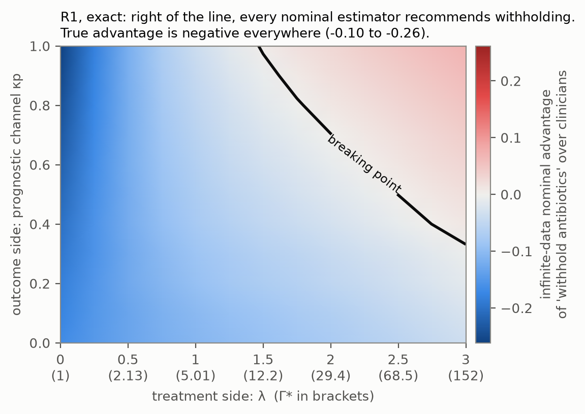
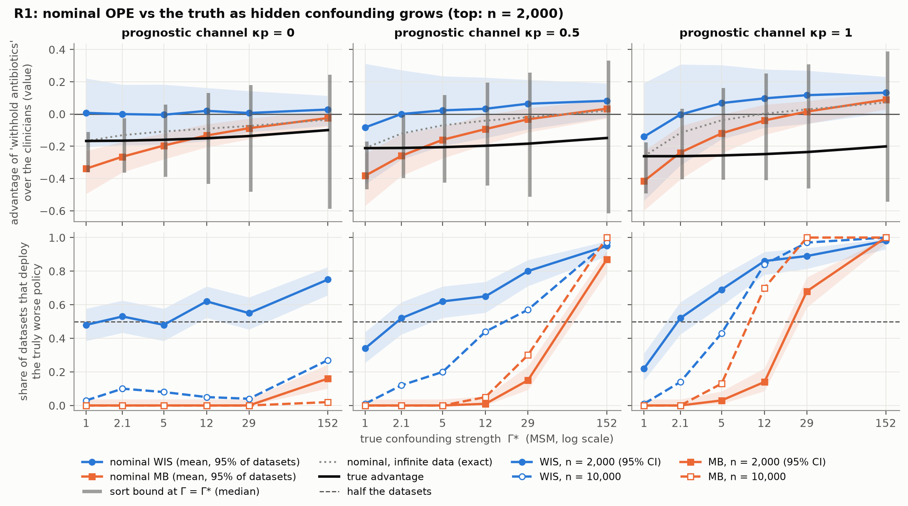
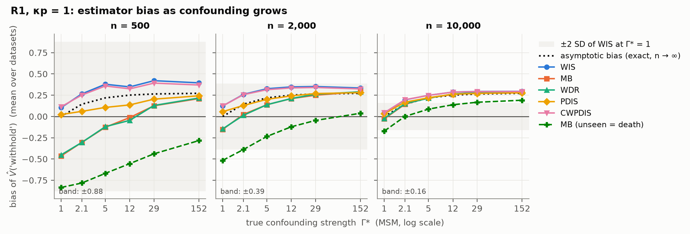
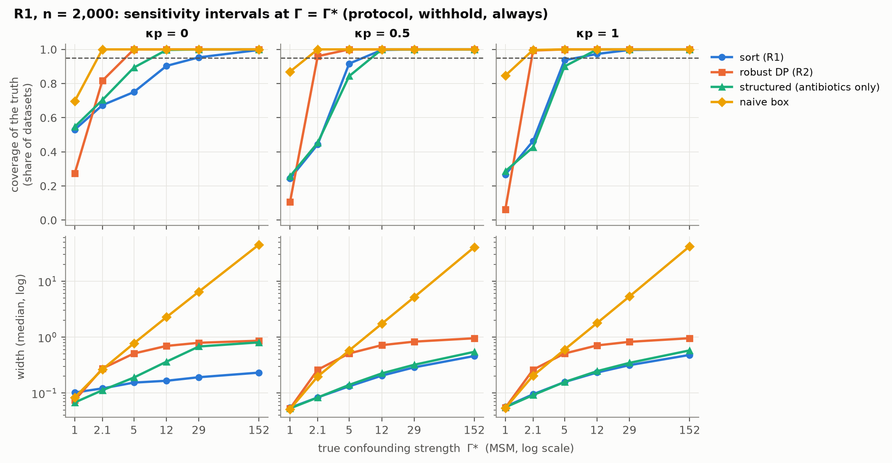
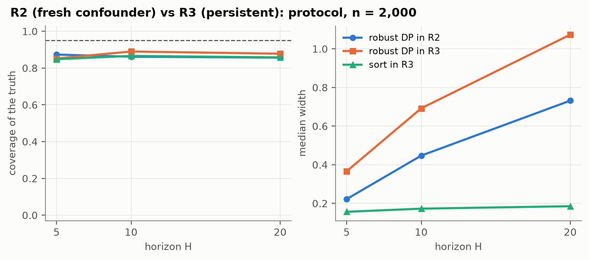
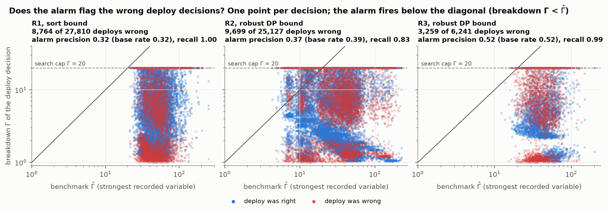
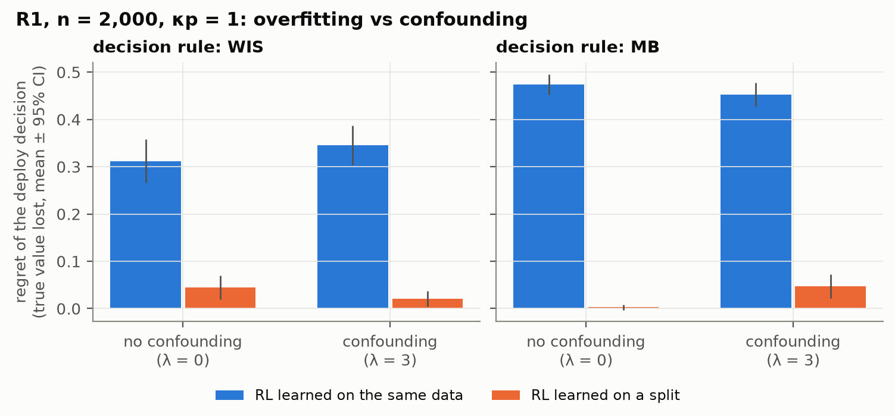

# Breaking Point: When Hidden Confounding Flips Off-Policy Evaluation

Vraj Detroja

November 2026 · doi: [10.5281/zenodo.23881233](https://doi.org/10.5281/zenodo.23881233)

## Abstract

Off-policy evaluation (OPE) is used to decide whether a treatment policy learned from hospital
records deserves a prospective trial, and every standard estimator assumes that the records
contain everything the clinicians acted on. This report studies what happens when they do not,
on the sepsis simulator of Oberst and Sontag (2019), extended with a hidden variable whose
strength is set exactly. Because the simulator is ported to an exact transition tensor, the true
value of every policy, the confounding strength Γ* under the marginal sensitivity model, and the
infinite-data limit of every estimator are computed rather than estimated. The strength of
confounding alone does not determine whether OPE recommends a worse policy. With infinite data,
the estimators prefer withholding antibiotics, which is truly worse than the clinicians' policy,
from Γ* = 12 when the hidden variable also worsens outcomes directly, and at no Γ* up to 152 when
it harms only untreated patients. With 10,000 episodes, weighted importance sampling and a
model-based estimate make this recommendation in 84% and 70% of datasets at Γ* = 12. With 2,000
episodes or fewer, the finite-sample biases of these two estimators, which have opposite signs,
are as large as the confounding bias. Sharp sensitivity bounds at the true Γ* cover the true
value in 96% to 99.9% of confounded datasets with 10,000 episodes, but a breakdown-point alarm
calibrated on recorded variables fires on 86% to 100% of deploy decisions, with a precision no
better than the base rate of wrong decisions.

## 1. Introduction

Off-policy evaluation estimates the value of a new treatment policy from data collected while
clinicians followed their own. It is how a policy learned from hospital records earns a clinical
trial. Every standard estimator assumes sequential ignorability: given the recorded history, the
clinicians' choice carries no further information about the outcome. Clinicians violate this
routinely, because they treat on what they see at the bedside, and much of that never reaches the
record.

On the simulator used here, Oberst and Sontag (2019) hid diabetes status, which the clinicians'
policy depended on, from the data. Averaged over 100 repetitions, a policy learned from those data
was rated 0.61 by weighted importance sampling and 0.81 by a model-based estimate, against an
observed 0.31 for the clinicians, while its true value was −0.27. Their experiment could not
separate the effect of confounding from that of small samples, or from overfitting the learned
policy to the data that also evaluated it. Namkoong et al. (2020) bounded the value of a policy
when a hidden confounder affects a single decision, under a sensitivity parameter Γ, and left the
choice of Γ to the analyst.

This report builds a controlled version of that experiment. A hidden variable of known strength
enters the clinicians' antibiotic decision and the patients' transitions, and every asymptotic
quantity is computed exactly. The contributions are:

1. **A confounded sepsis simulator with exact ground truth.** The sim-v2 simulator is ported to an
   exact transition tensor and validated against the original code. True values, the confounding
   strength Γ* and the infinite-data limit of every nominal estimator are computed by backward
   induction, which separates finite-sample error from asymptotic confounding bias.
2. **The breaking point has two sides.** Whether OPE recommends a worse policy depends on how the
   hidden variable affects outcomes, and not only on Γ*. With infinite data, OPE prefers withholding
   antibiotics from Γ* = 12 when the hidden variable also harms patients directly, and never when
   it harms only untreated patients. With 10,000 episodes the estimators follow this exact frontier;
   with 2,000 or fewer, their finite-sample biases decide.
3. **Bounds and an alarm, scored at scale.** Four sensitivity-bound constructions are compared on
   coverage and width, and a breakdown-point alarm on precision and recall over 59,178 deploy
   decisions. The bounds cover the truth where they are designed to once the sample is large; the
   alarm fires on nearly every decision.

## 2. Setup

### 2.1 Simulator

The sim-v2 sepsis simulator (Oberst and Sontag, 2019) describes a patient by heart rate, blood
pressure, oxygen saturation and glucose, each discretised into a few levels, by a diabetes
indicator, and by the three treatments currently on (antibiotics, vasopressors and mechanical
ventilation), for 1,440 states in all. Each of the 8 actions sets each treatment on or off.
Episodes last at most H = 20 steps. The reward is +1 at discharge, −1 at death and 0 otherwise,
including at the horizon, with no discounting, so the value V(π) of a policy is its expected
return and lies in [−1, 1]. Episodes start from the simulator's own start distribution:
treatments off and vitals drawn from their marginals, redrawn until the state is not absorbing
(74 states).

Within a step, the original code updates each vital sign independently given diabetes, the
treatments and the action, in a fixed order (antibiotics, ventilation, vasopressors, then random
drift). The next-state distribution is therefore a Kronecker product of small per-vital matrices,
which gives an exact transition tensor. The port is checked against the original sampling code
with chi-square tests on 200 random state-action pairs with 1,000 draws each and on 48 pairs with
100,000 draws each, and exact dynamic programming is compared with 10⁶ Monte Carlo episodes of the
original code. Both checks fail when a known glucose bug from the simulator's master branch is
reintroduced, or when one drift probability is changed from 0.10 to 0.13.

### 2.2 A hidden confounder with three channels

In regimes R1 and R2 a hidden binary variable u, with P(u = 1) = 0.3, marks a fast-moving
infection that the record does not capture. It acts through three channels:

- *Treatment.* The clinicians see u and add λ(2u − 1) to the logit of their antibiotic
  probability.
- *Outcome.* If u = 1 and antibiotics are off, heart rate moves from normal to high and blood
  pressure from normal to low, each with probability κ = 0.5.
- *Prognostic.* If u = 1, oxygen saturation moves from normal to low with probability κp, whatever
  the treatment.

λ sets how strongly the hidden variable confounds treatment. κ makes antibiotics more valuable for
patients with u = 1, and κp makes those patients worse off regardless of treatment. The regimes
differ in when the hidden variable acts:

- **R1.** u is drawn once per episode, and the channels and the tilt act at the first decision
  only, as in Namkoong et al. (2020).
- **R2.** A fresh u is drawn at every step, and the channels and the tilt act at every step.
- **R3.** There is no u. Diabetes, fixed for each patient, is hidden from the data, which leaves
  720 recorded states, and the clinicians follow a mixture of a diabetes-blind policy and a
  diabetes-aware one, with weight w on the latter.

### 2.3 Confounding strength

The data identify only the nominal propensity e(a | s) = Σ_u P(u | s) π_b(a | s, u), not the
clinicians' policy π_b(a | s, u) itself. Under the marginal sensitivity model (MSM; Tan, 2006)
with parameter Γ ≥ 1, the two differ by an odds ratio of at most Γ:

```math
\frac{1}{\Gamma} \;\le\; \frac{\pi_b(a \mid s, u)\,/\,\bigl(1 - \pi_b(a \mid s, u)\bigr)}{e(a \mid s)\,/\,\bigl(1 - e(a \mid s)\bigr)} \;\le\; \Gamma .
```

Γ = 1 is sequential ignorability. The true confounding strength Γ* is the smallest Γ for which the
inequality holds at every reachable (s, u, a), found by enumeration. In R1 and R2,
λ ∈ {0, 0.5, 1, 1.5, 2, 3} gives Γ* ∈ {1, 2.1, 5.0, 12, 29, 152}; in R3,
w ∈ {0, 0.25, 0.5, 0.75, 1} gives Γ* ∈ {1, 24, 67, 170, 813}. Rosenbaum's Γ, which compares the
clinicians' odds at u = 1 with those at u = 0 rather than either with the nominal propensity, is
exactly e^(2λ) for this tilt (Rosenbaum, 2002). It is larger than Γ* and is not used for the
bounds.

### 2.4 Policies

The protocol is the best policy that does not see u: value iteration with discount 0.99 on the
u-averaged dynamics, stationary, mixed with the uniform policy at ε = 0.1 so that every action has
probability at least 0.0125. In R1 the first decision uses a one-step lookahead on the u-averaged
first transition, since only that step depends on u. The clinicians follow the protocol, with its
antibiotic probability clipped to [0.05, 0.95] and then tilted by λ(2u − 1) at confounded steps.
Because the tilt is symmetric around the protocol, the clinicians' own value falls as λ grows.

Eight evaluation policies are scored: the clinicians' policy; the protocol; *withhold* and
*always*, the protocol with all antibiotic mass moved to off or to on at confounded steps, as in
Namkoong et al. (2020) (vasopressors in R3, where diabetes acts); three learned policies; and the
uniform random policy. The learned policies come from finite-horizon value iteration on the
empirical model, with unseen state-action pairs counted as death as in Oberst and Sontag (2019).
One is learned on the same data used to evaluate it, one on a separate half of the data, and one
with a pessimism penalty c / √n(s, a), c = 0.5, at every backup. Deterministic policies are
softened to put a total probability of 0.01 on the other actions.

### 2.5 Exact ground truth

True values come from backward induction on the joint hidden and recorded state. The
infinite-data limit of a nominal estimator is the value it converges to when the data identify only
e(a | s) and the observational transition kernel; it comes from backward induction on those
observational kernels. Its difference from the true value is the asymptotic confounding bias,
which is exactly zero without confounding (λ = 0, or w = 0 in R3).

## 3. Methods

### 3.1 Nominal estimators

Five estimators assume no hidden confounding: per-decision importance sampling (PDIS; Precup et
al., 2000), weighted importance sampling (WIS), consistent weighted per-decision importance
sampling (CWPDIS; Thomas, 2015), a tabular model-based estimate (MB), and weighted doubly robust
(WDR; Thomas and Brunskill, 2016) with MB as the control variate. Propensities and transitions are
estimated by counts. In R1 the first step is modelled separately from later steps, since only the
first decision is confounded; R2 and R3 pool all steps.

With 1,440 recorded states most states are visited only a handful of times, and two conventions
decide much of the finite-sample behaviour. Both were set using unconfounded data (λ = 0) only.

- *Propensity smoothing.* A total pseudo-count of 0.5 per state, spread over the 8 actions (0.0625
  each). A pseudo-count of 0.5 per action would pull the greedy action's propensity in a state
  visited once from 0.91 to about 0.3; without confounding, that inflates PDIS by +0.69, +0.14 and
  +0.03 at n = 500, 2,000 and 10,000, against +0.004, +0.001 and +0.004 with the per-state
  pseudo-count.
- *Unseen state-action pairs.* Where the evaluation policy puts mass on an action never observed in
  a state, MB renormalises the policy over the observed actions; a state with no observed action
  scores −1. Scoring unseen pairs as death, as in Oberst and Sontag (2019), biases MB by −0.31,
  −0.17 and −0.05 for the clinicians' own policy without confounding, while renormalising gives
  +0.06, +0.035 and +0.014. The death-scoring version is reported as a sixth estimator,
  MB (unseen = death).

Uncertainty comes from an episode-level bootstrap with B = 200 resamples, refitting propensities
and models in each; intervals are percentile 95% intervals. Learned policies are held fixed across
resamples.

### 3.2 Sensitivity bounds

Let W = 1 / π_b(a | s, u) be the true inverse propensity of the action taken and ω = e(a | s) W its
rescaled version. Under the MSM at Γ,

```math
\omega \in \left[\, e + \frac{1 - e}{\Gamma},\; e + \Gamma\,(1 - e) \,\right], \qquad \mathbb{E}\left[\,\omega \mid s, a\,\right] = 1 ,
```

so the smallest mean of an outcome that the model allows within an (s, a) cell puts the upper
weight on the lowest 1 / (1 + Γ) share of the cell's mass and the lower weight on the rest. The
sharp bound is a sort (Dorn and Guo, 2023). Four constructions are compared, each at Γ = Γ* of the
matching regime:

- **Sort** (R1). Within each first-step (s, a) cell, sort Z = r₀ + V̂₁(s₁), where V̂₁ is fitted on
  steps 1 and later. Cells with fewer than 20 visits are pooled over glucose levels.
- **Robust DP** (R2, R3). The same sort applied to every row of the empirical model at every step,
  backward from the horizon: the robust Bellman operator of Bruns-Smith and Zhou (2023).
- **Structured** (R1). Only the binary antibiotic factor of the action is tilted, at the
  factor-level Γ*, after the identified ventilation and vasopressor choices are reweighted
  nominally.
- **Box.** The inverse propensity at confounded steps is replaced by its upper or lower limit
  according to the sign of the return: the MSM version of the naive bound of Namkoong et al. (2020).

The reported interval runs from the 5th percentile of the bootstrapped lower bounds to the 95th
percentile of the bootstrapped upper bounds. At Γ = 1 every bound collapses to its nominal value.

### 3.3 Decisions, breakdown Γ and the alarm

An evaluation policy is deployed if its estimated value exceeds the clinicians' mean observed
return, and a deployment is wrong if the policy's true value is below the clinicians'. For a given
bound, the breakdown Γ of a deploy decision is the largest Γ in [1, 20] at which the plug-in lower
bound still exceeds the clinicians' mean observed return, found by bisection to a tolerance of
10⁻³. The alarm analysis uses the decisions in which the bound's own value at Γ = 1 says deploy.
The benchmark Γ̂ follows Hsu and Small (2013): for each recorded variable, the propensity model is
refitted without it, the MSM odds ratio between the full and the reduced propensity is computed for
every (s, a) visited at least 20 times, and its 95th percentile is taken; Γ̂ is the maximum over
variables. The alarm fires when the breakdown Γ is below Γ̂. An oracle alarm uses Γ* in place of
Γ̂.

### 3.4 Metrics

| Metric | Definition |
| --- | --- |
| Bias, RMSE | mean and root mean square of (estimate − true value) over the datasets of a cell |
| Asymptotic bias | exact infinite-data limit − true value |
| CI coverage | share of datasets whose 95% interval contains the true value |
| Wrong-deploy rate | share of datasets in which OPE deploys the evaluation policy although its true value is below the clinicians' |
| Breaking point | smallest Γ* at which the wrong-deploy rate exceeds one half |
| Exact breaking point | smallest Γ* at which the infinite-data nominal limit recommends deploying |
| Regret | true value lost by the deploy decision, relative to the better of the evaluation policy and the clinicians |
| Bound coverage, width | share of datasets whose interval at Γ = Γ* contains the true value; median width |
| Alarm precision, recall | among deploy decisions, the share of alarms that fall on wrong decisions, and the share of wrong decisions that raise an alarm |

Shares are over 100 datasets per cell. Where they matter, 95% Wilson intervals are given in
brackets.

## 4. Experimental design

The main grid crosses R1 and R2 with λ ∈ {0, 0.5, 1, 1.5, 2, 3}, κp ∈ {0, 0.5, 1} and
n ∈ {500, 2,000, 10,000} episodes, and R3 with w ∈ {0, 0.25, 0.5, 0.75, 1} at the same sample
sizes. Two ablations at n = 2,000 weaken the outcome channel (κ = 0.25) and use an intermediate
prognostic channel (κp = 0.3). A horizon sweep repeats R2 and R3 at H = 5 and H = 10 with
n = 2,000 and κp = 0. This gives 169 cells with 100 datasets each, and 1,127,800 result rows, one
per cell, dataset, evaluation policy and method. Each dataset's seed is spawned from a root seed by
cell and replicate, and every estimator and bound is computed on the same datasets, so comparisons
between methods are paired.

## 5. Results

### 5.1 The breaking point depends on the outcome side of the confounder

In R1, withholding antibiotics is truly worse than the clinicians' policy by 0.10 to 0.26 in every
cell. Table 1 gives its true advantage over the clinicians next to the infinite-data limit of the
nominal estimate of that advantage.

_Table 1. Advantage of withholding antibiotics over the clinicians in R1 (κ = 0.5): true value /
infinite-data nominal limit. A positive nominal limit (bold) means that every consistent nominal
estimator eventually recommends the worse policy._

| κp | Γ* = 1 | 2.1 | 5.0 | 12 | 29 | 152 |
| --- | --- | --- | --- | --- | --- | --- |
| 0 | −0.167 / −0.167 | −0.165 / −0.131 | −0.160 / −0.108 | −0.150 / −0.091 | −0.137 / −0.074 | −0.100 / −0.035 |
| 0.3 | −0.193 / −0.193 | −0.192 / −0.126 | −0.187 / −0.087 | −0.178 / −0.063 | −0.165 / −0.044 | −0.130 / −0.005 |
| 0.5 | −0.211 / −0.211 | −0.210 / −0.121 | −0.205 / −0.070 | −0.197 / −0.041 | −0.184 / −0.020 | −0.149 / **+0.020** |
| 1 | −0.261 / −0.261 | −0.261 / −0.117 | −0.257 / −0.039 | −0.248 / **+0.002** | −0.236 / **+0.029** | −0.201 / **+0.071** |

The nominal limit crosses zero at Γ* = 12 when the hidden variable also lowers oxygen regardless of
treatment (κp = 1), at Γ* = 152 when κp = 0.5, and at no Γ* in the grid when κp ≤ 0.3. Γ* alone
does not locate the breaking point, and the channels explain why. With the outcome channel alone,
patients with u = 1 are harmed only when they go untreated, so confounding can at most make
withholding look like withholding from patients with u = 0, which is still worse than treating
them. A stronger outcome channel moves the bias and the true gap together: with κ = 1 and κp = 0
the nominal limit is still −0.036 at Γ* = 152. A flip needs the hidden variable to worsen outcomes
whatever the treatment, which is what the prognostic channel does. Figure 0 maps this frontier on a
finer grid.



_Figure 0. Exact infinite-data nominal advantage of withholding antibiotics over the clinicians in
R1, by treatment-side strength λ (Γ* in brackets) and prognostic strength κp. To the right of the
line every nominal estimator converges to recommending withholding, while the true advantage is
negative everywhere (−0.10 to −0.26)._

With 10,000 episodes the estimators follow the exact frontier (Figure 1). At κp = 1, WIS
recommends withholding in 84% [76, 90] of datasets at Γ* = 12 and MB in 70% [60, 78], up from 43%
and 13% at Γ* = 5. At κp = 0 they do so in at most 27% (WIS) and 2% (MB) of datasets, even at
Γ* = 152.



_Figure 1. Withholding antibiotics in R1. Top: true advantage over the clinicians (black),
infinite-data nominal limit (dotted), nominal WIS and MB at n = 2,000 (mean and central 95% of
datasets), and the median sort interval at Γ = Γ* (grey bars). Bottom: share of datasets in which
WIS and MB recommend the truly worse policy, at n = 2,000 (solid, with 95% Wilson band) and at
n = 10,000 (dashed)._

### 5.2 With 2,000 episodes or fewer, finite-sample bias decides

With n ≤ 2,000 the two primary estimators err in opposite directions before any confounding
exists (Figures 1 and 2). Without confounding, WIS already recommends withholding in 22% to 49% of
datasets, with a bias of +0.13 to +0.17 at κp = 0. At n = 2,000 a majority of its decisions are
wrong from Γ* = 2.1 at every κp except 0.3 (from Γ* = 5.0), including κp = 0, where infinite data
never flip the decision. MB is biased low for a policy this far from the data (−0.46 to −0.51 at
n = 500 and −0.15 to −0.17 at n = 2,000 without confounding). It recommends withholding in at most
3% of datasets below Γ* = 12, and reaches a majority only at Γ* = 29 (κp = 1, n = 2,000).

The confounding part of the bias grows with Γ* and does not shrink with n. At κp = 1 and
Γ* = 152 the exact asymptotic bias is +0.27, and at n = 10,000 every nominal estimator except
MB (unseen = death) lies within 0.03 of it. Even for the protocol, the policy closest to the
clinicians', the 95% intervals of WIS, MB and WDR cover the true value in only 2% to 48% of
datasets at Γ* = 1, against 90% to 97% for PDIS.



_Figure 2. Bias of each nominal estimator for the value of withholding antibiotics (R1, κp = 1)
against Γ*, by sample size, with the exact asymptotic bias (dotted) and a band of ±2 standard
deviations of WIS at Γ* = 1 (grey)._

The bias of WIS at Γ* = 1 comes from the estimated propensities rather than from the estimator.
For the protocol, WIS is biased by +0.084, +0.052 and +0.020 at n = 500, 2,000 and 10,000
(R1, κp = 0, λ = 0). Rerunning WIS on 30 of the same datasets with the exact nominal propensities,
which no analyst could know, removes most of the bias (Table 2). In a state visited once, the
observed action receives a propensity of about 0.7 whatever it was, so episodes in which the
clinicians tried a rare and usually worse action are down-weighted, and WIS over-represents the
protocol's greedy path.

_Table 2. Bias of WIS without confounding (R1, λ = 0, n = 2,000, 30 datasets; standard errors in
brackets), with count-based and with exact propensities._

| κp | Policy | Count-based propensities | Exact propensities |
| --- | --- | --- | --- |
| 0 | protocol | +0.050 (0.003) | +0.002 (0.003) |
| 0 | withhold | +0.171 (0.028) | +0.017 (0.029) |
| 1 | protocol | +0.043 (0.002) | −0.001 (0.003) |
| 1 | withhold | +0.055 (0.038) | −0.040 (0.026) |

### 5.3 The bounds cover where they are designed to, given enough data

Table 3 summarises coverage and width at Γ = Γ* > 1, pooled over the protocol, withhold and always
policies. In R1 the sort bound covers the true value in 77%, 87% and 99.9% of datasets at
n = 500, 2,000 and 10,000, with a median width of 0.21 to 0.28 on a value scale of 2. The
structured bound, which uses the knowledge that only antibiotics are confounded, covers about as
often and is no narrower. Robust DP covers more often at two to four times the width. The box
covers 99% to 100% of datasets, but its median width of 1.5 to 1.9 spans most of the value range,
and it grows with Γ* well beyond it (Figure 3). In R2, where confounding acts at every step, robust DP covers 76%,
86% and 96% of datasets, the sort, which assumes a single confounded step, only 51% to 65%, and the
box is hundreds to thousands wide.

_Table 3. Coverage of the true value at Γ = Γ* > 1 (median width in brackets), pooled over the
protocol, withhold and always policies._

| Regime | Bound | n = 500 | n = 2,000 | n = 10,000 |
| --- | --- | --- | --- | --- |
| R1 | sort | 77% (0.28) | 87% (0.23) | 99.9% (0.21) |
| R1 | structured | 75% (0.30) | 88% (0.27) | 99% (0.24) |
| R1 | robust DP | 86% (0.51) | 98.5% (0.66) | 100% (0.79) |
| R1 | box | 99% (1.5) | 100% (1.7) | 100% (1.9) |
| R2 | robust DP | 76% (0.45) | 86% (0.57) | 96% (0.62) |
| R2 | sort | 53% (0.28) | 51% (0.24) | 65% (0.20) |
| R2 | box | 91% (794) | 94% (4,965) | 96% (5,355) |
| R3 | robust DP | 65% (0.62) | 68% (0.78) | 100% (1.00) |

Under-coverage comes from the plug-in estimates rather than from the sensitivity model. At Γ* = 1
each interval collapses to a bootstrap interval around its point estimate, and it covers the true
value in only 16% to 59% of datasets (the sort in R1, robust DP in R2): this is the finite-sample
bias of Section 5.2. In R3, hidden diabetes persists over the whole episode, which violates robust
DP's step-by-step model of the confounder. Robust DP still covers the protocol and the withholding
policy in at least 96% of confounded datasets at every n. For the policy that always gives
vasopressors it covers 0% at n = 500 and 2.5% at n = 2,000, and 100% at n = 10,000, where Γ* is
large (24 to 813) and the step-wise interval is about half the value range wide.



_Figure 3. Coverage of the true value (top) and median width (bottom, log scale) of the four
sensitivity intervals at Γ = Γ*, in R1 with n = 2,000, pooled over the protocol, withhold and always
policies. The dashed line marks 95%._

Longer horizons widen the bounds without lowering their coverage (Figure 4). For the protocol at
n = 2,000 and Γ* > 1, robust DP covers at least 99.6% of datasets at H = 5, 10 and 20 in R2 and
all of them in R3, while its median width grows from 0.22 to 0.73 in R2 and from 0.37 to 1.07 in
R3.



_Figure 4. Coverage (left) and median width (right) of the bounds on the protocol's value against
the horizon H, at n = 2,000: robust DP in R2, where its model of the confounder is correct, and
robust DP and the sort in R3, where it is not. Coverage is pooled over all confounding levels; the
gap below 95% (dashed) comes from the unconfounded cells, and above Γ* = 1 every point covers at
least 99.6% of datasets._

### 5.4 The alarm cannot separate right decisions from wrong ones

The benchmark Γ̂ ranges from 21 to 250 over the R1 deploy decisions (median 49), above the
breakdown search cap of 20, so the alarm fires on all 27,810 of them: recall 1.00 and precision
0.32, which equals the base rate of wrong deployments (Figure 5). With robust DP it fires on 86% of
the R2 decisions and 99.6% of the R3 decisions, with precision 0.37 and 0.52 against base rates of
0.39 and 0.52. Γ̂ is large because the protocol is a nearly deterministic function of the vitals:
dropping heart rate or blood pressure from the propensity model changes it by large odds ratios.
The benchmark therefore measures how deterministic the clinicians are rather than how strong the
hidden confounding is. An oracle alarm that uses the true Γ* is not sharper: its precision is 0.32,
0.34 and 0.58 and its recall 0.52, 0.52 and 0.84 in R1, R2 and R3.

Most wrong deployments come from overfitting rather than confounding. Between 75% and 80% of them,
in each regime, are the RL policy evaluated on its own training data. Its lower bound still clears the
clinicians' return at the search cap in 73% (R1) and 55% (R2) of its deployments, so no
confounding analysis can flag it.



_Figure 5. Breakdown Γ against the benchmark Γ̂ for every deploy decision, using the sort bound in
R1 and robust DP in R2 and R3. The alarm fires below the diagonal; the breakdown Γ is searched up
to 20 (dashed). Red crosses are wrong deployments and blue dots correct ones._

### 5.5 Overfitting, rather than confounding, sinks the learned policy

The RL policy learned on the same data that evaluate it is truly worse than the clinicians' policy
in every R1 dataset (true value −0.74 to 0.28, against 0.21 to 0.39 for the clinicians), although
with infinite data the learned policy would beat them at every λ (0.56 against 0.39 without
confounding). MB recommends it in every dataset, and WIS in 46% to 94% of datasets depending on
the cell, with or without confounding. At κp = 1 and n = 2,000 the regret of the deploy decision is
0.31 (WIS) and 0.47 (MB) without confounding, and 0.35 and 0.45 at λ = 3 (Figure 6). Learning the
policy on one half of the data and evaluating it on the other cuts the regret to 0.05 or less.
Sample splitting removes the overfitting; in R1 the confounding part of this decision is too small
to see.



_Figure 6. Regret of the deploy decision for the RL policy in R1 (n = 2,000, κp = 1), learned on
the data that evaluate it or on a separate half, without confounding (λ = 0) and with strong
confounding (λ = 3). Error bars are 95% confidence intervals of the mean._

## 6. Discussion

The results describe how the methods behave, not clinical effect sizes, and three of these
behaviours should carry over to other settings.

First, the sensitivity parameter Γ describes only the treatment side of a confounder, while
whether a decision flips also depends on its outcome side. The same Γ* = 12 flips the decision when
the hidden variable harms outcomes directly and leaves it intact when it does not. A sensitivity
analysis that reports a single Γ, as a breakdown point or as a benchmark, cannot tell these cases
apart. Calibrating the outcome side of a sensitivity model, and not only the treatment side, is a
natural next question.

Second, at the sample sizes of a typical retrospective study, the finite-sample bias of tabular
estimators is as large as the confounding bias, the two primary estimators err in opposite
directions, and bounds centred on these estimators inherit the error. Here the exact infinite-data
limits separate the two sources. On real data nothing does, which makes cross-fitted or debiased
bounds the obvious next step.

Third, a benchmark Γ̂ calibrated by dropping recorded variables measures how deterministic the
behaviour policy is, not how strong the hidden confounding is. In R1 a near-deterministic protocol
gives Γ̂ between 21 and 250 while Γ* runs from 1 to 152, and the alarm carries no information about
which decisions are wrong. The largest source of wrong deployments was overfitting, which sample
splitting fixes and which sensitivity analysis cannot detect.

**Limitations.** The study uses a simulator, not patients, and the confounding is injected rather
than discovered. The estimators are tabular, so the results say nothing about function
approximation. The clinicians' tilt is symmetric around the protocol, so their value falls as λ
grows; this is a modelling choice. Γ* is computed by enumerating reachable states, which no analyst
can do. The benchmark (95th percentile, one recorded variable dropped at a time) is one of several
possible calibrations. The hidden variable in R1 and R2 is binary. With 100 datasets per cell, a
share near one half is known to within about 10 percentage points.

## Appendix A. Validation

Every property below is checked by the test suite (`make test`; the two slow checks run with
`make validate`).

| Property | Test |
| --- | --- |
| Transition rows are distributions, and the next treatments follow the action | `test_dynamics_port.py` |
| The port matches the original code: chi-square on 200 pairs × 1,000 draws, and on 48 pairs × 100,000 draws (slow); the start distribution matches the original | `test_dynamics_port.py` |
| Exact values match 10⁶ Monte Carlo episodes, including the protocol's value under the original simulator (slow) | `test_truth_vs_mc.py` |
| Γ* = 1 at λ = 0, Rosenbaum's Γ = e^(2λ), and Γ* grows with w in R3 | `test_gamma_star.py` |
| Without confounding the asymptotic bias is zero; values lie in [−1, 1] | `test_gamma_star.py` |
| The sort equals a generic linear program on 1,000 random cells, and so does the robust backup; the vectorised forms match the reference forms | `test_sort_matches_lp.py` |
| Bounds collapse to the nominal value at Γ = 1, widen with Γ, and bracket the truth at Γ* with infinite data | `test_bounds_collapse_and_widen.py` |
| The sort lies inside the box | `test_sort_inside_box.py` |
| WIS equals MB in a one-step problem | `test_wis_equals_mb_one_step.py` |
| The example of Namkoong et al. (2020, Section 4): equal true values, a wrong ranking with infinite data, and a gap that grows with the horizon | `test_namkoong_toy.py` |
| Estimators never receive hidden columns; returns lie in {−1, 0, 1}; no two datasets share a seed; PDIS with the exact propensities is unbiased without confounding | `test_pipeline_integrity.py` |

## Appendix B. Reproduction

Every number in this report is computed by `make figures` from the result rows in `results/`, and
stored in `figures/summary.json`, `figures/table_estimators.csv`, `figures/table_bounds.csv`,
`figures/design_frontier.csv` and `figures/oracle_wis.csv`. Each result row records the commit of
the code that produced it and a hash of its configuration. The commands that regenerate the rows
are in the [README](README.md#reproduce). The code, the result rows and this report are archived on
Zenodo at https://doi.org/10.5281/zenodo.23881233.

## References

Bruns-Smith, D. and Zhou, A. (2023). Robust fitted-Q-evaluation and iteration under sequentially
exogenous unobserved confounders. arXiv preprint.

Dorn, J. and Guo, K. (2023). Sharp sensitivity analysis for inverse propensity weighting via
quantile balancing. *Journal of the American Statistical Association*.

Hsu, J. Y. and Small, D. S. (2013). Calibrating sensitivity analyses to observed covariates in
observational studies. *Biometrics*.

Namkoong, H., Keramati, R., Yadlowsky, S. and Brunskill, E. (2020). Off-policy policy evaluation
for sequential decisions under unobserved confounding. *Advances in Neural Information Processing
Systems*.

Oberst, M. and Sontag, D. (2019). Counterfactual off-policy evaluation with Gumbel-max structural
causal models. *International Conference on Machine Learning*.

Precup, D., Sutton, R. S. and Singh, S. (2000). Eligibility traces for off-policy policy
evaluation. *International Conference on Machine Learning*.

Rosenbaum, P. R. (2002). *Observational Studies*, 2nd edition. Springer.

Tan, Z. (2006). A distributional approach for causal inference using propensity scores. *Journal
of the American Statistical Association*.

Thomas, P. S. (2015). *Safe Reinforcement Learning*. PhD thesis, University of Massachusetts
Amherst.

Thomas, P. S. and Brunskill, E. (2016). Data-efficient off-policy policy evaluation for
reinforcement learning. *International Conference on Machine Learning*.
